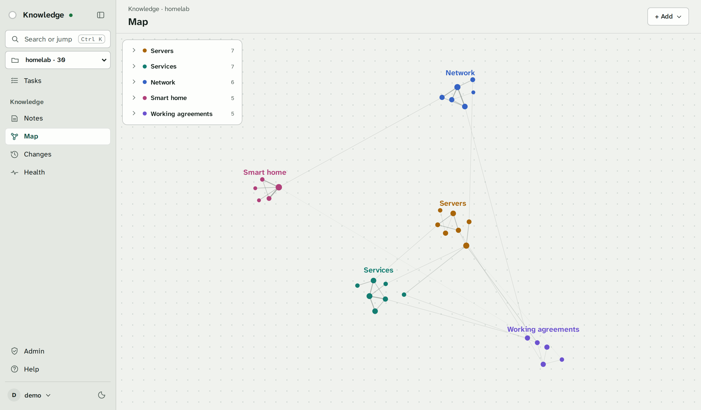

# knowledge

[](docs/memory.md#search-quality)
[](docs/memory.md#search-quality)
[](https://github.com/To0wnn/knowledge/actions/workflows/clients.yml)
[](https://github.com/To0wnn/knowledge/releases)
[](LICENSE)

**Your coding agents share one memory and hand work to each other across your own PCs — and you steer them from
your phone. Self-hosted, plain Markdown.**

Works with Claude Code, Codex and Antigravity (agy, Gemini) on Linux, macOS and Windows. Made for solo developers and
homelabbers with two or more PCs and two or more agents who want their notes to stay on their own server.

- **One memory, every agent.** Tell Claude Code something on your laptop; Codex on your desktop knows it. Notes are
  plain Markdown files on your disk, found by meaning (98.8% R@5 on LongMemEval-S, embeddings run locally).
- **Agents hand work to each other.** One line in a note hands a task to another agent; it runs once, on one of your
  PCs, in its own git branch, and the result comes back to whoever asked.
- **You steer from your phone.** An inbox of what needs you, chats with the agents on your PCs, and Allow/Deny for
  each risky step, in a web app you install on your phone.

<picture>
  <source media="(prefers-color-scheme: dark)" srcset="demo/map-dark.png">
  
</picture>

<sub>Made-up demo notes from <code>demo/</code>.</sub>

<!-- Screenshots to add (demo/screenshot.py, made-up data only):
     1. phone Inbox with the "Needs you" column
     2. a chat on the phone with an approval (Allow once / Allow for this chat / Deny)
     3. the mission map (Tasks > Flow)
     4. the memory graph (above)
     5. the Machines list -->

You can use it in two layers. **Memory** is the server plus one agent: five minutes, nothing else on your PCs.
**Cockpit** adds the companion on each PC, so tasks run as workers and you can chat and approve from your phone.

## Quickstart: Memory

You need Docker and about 2 GB RAM on the server, and git plus Python 3.9 or newer on each PC.

**1. Run the server.**

```sh
git clone https://github.com/To0wnn/knowledge && cd knowledge
mkdir data && echo "KNOWLEDGE_UI_PASSWORD=<a long password>" > .env
docker compose up -d
```

**2. Get the first token.** The first start makes one admin token and prints it once, with the next steps:

```sh
docker compose logs knowledge
```

Tokens for more devices: open `http://localhost:8766/ui`, sign in with the password and use the admin page (Admin);
it shows the install line with your server address filled in.

**3. Connect an agent** on the same PC:

```sh
curl -fsSL https://raw.githubusercontent.com/To0wnn/knowledge/main/install.sh | sh   # Linux, macOS
```

```powershell
irm https://raw.githubusercontent.com/To0wnn/knowledge/main/install.ps1 | iex        # Windows
```

It finds Claude Code, Codex and agy, asks y/n for each, and asks for the server address
(`http://localhost:8766`) and the token. Run the same line again later to update.

**4. Try it.** Tell Claude Code: *"save to knowledge: we deploy with ./deploy.sh"* (the installer turns Claude's own
local auto-memory off, so it writes a memo on the server). Then start Codex (or agy), on this pc or another, and ask
*"how do we deploy?"*. It answers from the shared memory.

**More than one PC?** Put the server behind HTTPS (a reverse proxy) and add its `host:port` to
`KNOWLEDGE_ALLOWED_HOSTS` in `.env`; then run the install line on every PC with a token per device. Over plain HTTP
the password and tokens cross the network readable. All settings: [docs/server.md](docs/server.md).

## Add the Cockpit

The install line also sets up the **companion**, a small local service on each PC (`127.0.0.1:47321`, starts at
logon). With it:

- **Workers.** A task handed to an agent runs as a fresh headless session in its own git worktree and branch, at most
  one per agent by default, paused at 90% of the agent's usage limit. Workers are off until you tick "Workers
  allowed" on the companion's page. **Follow** a worker to watch it live in the chat view, steer it between steps, or
  take it over as a chat. [docs/tasks.md](docs/tasks.md)
- **Chats from your phone.** Open the web UI on your phone and install it as an app; start a chat with Claude Code,
  Codex or agy in a project folder on one of your PCs. The answer streams in as in a terminal.
  [docs/chats.md](docs/chats.md)
- **Approvals.** Without YOLO, an agent in a chat may edit files in its folder and asks you for anything else:
  **Allow once**, **Allow for this chat** or **Deny**, on the phone or in the Inbox. [docs/chats.md](docs/chats.md)
- **Inbox and Machines.** One board of what needs you, what runs and what is done; per PC its agents, workers,
  usage and a fixed set of remote actions (no remote shell). [docs/companion.md](docs/companion.md)

To use it from your phone, the server must be reachable from the phone over HTTPS. Link a project folder once by
asking your agent to run the skill `knowledge-init`.

## Compared with

Each of these is good at its own part; knowledge is the one that combines shared memory, hand-overs and a phone
cockpit across several agents and PCs.

| Tool | What it does well | Where knowledge differs |
|---|---|---|
| [claude-mem](https://github.com/thedotmack/claude-mem) | Automatic session memory for Claude Code, local | One server for Claude Code, Codex and agy on all your PCs; plain Markdown you edit |
| [basic-memory](https://github.com/basicmachines-co/basic-memory) | Local Markdown knowledge base over MCP | Adds shared multi-PC serving, house-rule lint, duplicate checks and agent hand-overs |
| Happy, Omnara, Claude Code Remote Control | Steer a running agent session from your phone | Also memory and tasks between agents; self-hosted, no third-party relay |
| Conductor, Superset | Run parallel agents in worktrees on one Mac or desktop | Workers on any of your PCs (Linux, macOS, Windows), started from a shared task list |
| [Vibe Kanban](https://github.com/BloopAI/vibe-kanban) | Kanban board that runs coding agents in worktrees | Tasks are lines in your notes, agents hand them to each other, steered from the phone |

## Honest limits

- **A server to run:** Docker, about 2 GB RAM, an image of about 1.5 GB (the embedding model ships in it).
- **HTTPS for more than one PC** or the phone: you put a reverse proxy in front.
- **Agents:** Claude Code, Codex and Antigravity (agy) only.
- **Notifications:** Matrix only, and the one-machine `compose.yaml` needs a small edit for it
  ([docs/server.md](docs/server.md#notifications)).
- **One admin:** password sign-in is for one person; several people need a reverse proxy with forward auth.
- **First token** is made in the web UI, not by a command.
- **One maintainer**, built for their own use first. Issues and pull requests welcome.

Known gaps: [docs/ROADMAP.md](docs/ROADMAP.md).

## How it works

- **Server** (`server/`): Python in one Docker container, MCP over streamable HTTP plus the web UI. All notes sit in
  memory; search and embeddings (EmbeddingGemma, ONNX) run locally, nothing leaves the machine.
- **Notes:** plain Markdown in `data/`, with a `MEMORY.md` index per project, a few house rules and a lint that keeps
  agent memory findable and free of duplicates.
- **Plugin** (`plugin/`): one folder that installs in Claude Code, Codex and agy: the MCP server, session-start
  context, hand-over checks each turn, and development skills. Tokens live in the OS keyring.
- **Tasks:** a hand-over is a line in a note (`- open until <date> [<Owner>, <ID>] from <Requester>, start ...: <what>`);
  the server decides when it may start and gives it to one machine only.
- **Companion** (`clients/`, `plugin/companion`): pulls tasks, actions and chat messages from the server; the server
  never connects to your PCs.

## Documentation

| Page | Contents |
|---|---|
| [server.md](docs/server.md) | Running the server, `.env` settings, proxy sign-in, notifications |
| [clients.md](docs/clients.md) | The installer, updates, linking folders, Windows, skills, usage limits, secret guard |
| [memory.md](docs/memory.md) | MCP tools, session start, projects, lint, duplicates, secrets, search quality |
| [tasks.md](docs/tasks.md) | Task lines, leases and nonces, results, workers, usage limit, mission map |
| [companion.md](docs/companion.md) | The companion, machines, own devices, remote control, YOLO safety |
| [chats.md](docs/chats.md) | Inbox, chats and approvals |
| [web-ui.md](docs/web-ui.md) | Views, routes, graph, installing as an app (PWA, cookies) |
| [security.md](docs/security.md) | The security model in one page |
| [development.md](docs/development.md) | Tests, CI, plugin versions, screenshots |
| [ROADMAP.md](docs/ROADMAP.md) | Known gaps |

## License

MIT, see [LICENSE](LICENSE).

The server image includes the EmbeddingGemma model weights. Gemma is provided under and subject to the Gemma Terms of
Use found at [ai.google.dev/gemma/terms](https://ai.google.dev/gemma/terms); its use is also subject to the
[Gemma Prohibited Use Policy](https://ai.google.dev/gemma/prohibited_use_policy). The weights are not modified.
