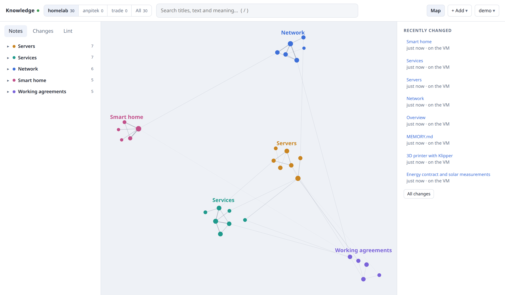

# knowledge

A small self-hosted knowledge server for AI coding agents. It gives Claude Code, Codex and Antigravity (agy) on every
device the same live docs and memory, over MCP, plus a web UI with a graph of how the notes connect.

Notes are plain Markdown files on disk. The server indexes them, serves them to agents with a per-device token, and
checks them against a few house rules, so a growing pile of agent memory stays findable and tidy.

<picture>
  <source media="(prefers-color-scheme: dark)" srcset="demo/map-dark.png">
  
</picture>

<sub>Made-up demo notes from <code>demo/</code>; regenerate with <code>uv run --project server --with playwright python demo/screenshot.py</code>.</sub>

## What it does

- **MCP tools for agents:** search (regex and semantic), read, list, related notes, write and edit (with conflict
  checks), new memo, delete (kept as a copy), history, lint, and ingest of a web page, PDF or text as a raw source.
- **Session start context:** each agent gets the shared instructions, the house rules and the memory index of the
  project it works in, plus open items whose date has passed and hand-over tasks between agents.
- **Hand-overs during a session:** before a prompt (at most every two minutes) Claude Code, Codex and agy ask
  `/tasks` for the tasks handed to them; a task added after the session started is told to the agent once.
  The same per-turn call lets the server steer every session, also a resumed one that ran no start hook: notices
  (such as docs moved into an archive folder) go to the first session of the device that asks, offered again after an
  hour when that session had no further turn, and one session is asked to run a full docs mirror sync in the
  background when the device's last one is older than `docs_sync_minutes` (admin page, Settings).
- **Waking another agent (same machine):** after a `knowledge_edit`/`knowledge_write`/`knowledge_new_memo`, the
  plugin wakes the newest idle session per agent and project on that machine that has a new task: Codex through
  `codex queue --thread`, agy through its local language server (the agy session registers once by running
  `agent_hooks.py register` as a terminal command, the plugin asks it to), Claude Code through an `asyncRewake`
  waiter hook. The woken agent tells the user and waits for consent. The admin page lists per token the sessions
  seen in the last week (agent, session id, project, wakeable), each with a Forget button.
- **Projects:** each project has a docs root and a memory root. A session picks its project from its working folder;
  a token can also be limited to one project (a guest). The admin page gives a project the name the web UI shows;
  a built-in project with no notes on your installation gets no tab.
- **Lint:** deterministic checks in ~80 ms: dead links, index lines without a file and the reverse, missing frontmatter
  or sections, oversized memos, overdue open items, probable secrets (never shown), raw sources not yet processed.
- **Web UI:** a home view per topic, full search, a note preview with connected notes, an editor, change history, a
  lint tab and an admin page for tokens, people and projects. Light or dark, your pick.
- **Graph:** notes as nodes, links as lines, one island per topic. A line's thickness and pull follow how related two
  notes are (direct link, shared source, shared neighbours, same type); weak links between topics show on hover.
- **External skills:** an admin adds a skill folder from GitHub by its link; it is pinned to a commit, taken in only as
  plain text (no tools, hooks or load-time commands, a licence that allows copying) and shared like your own skills.
  A weekly check takes small updates in by itself and holds big or unsafe ones for the admin; local additions below
  `<!-- local -->` survive updates.
- **Archive:** folders such as `archief/`, `archive/`, `old/` or `history/` are skipped by search unless asked for.
- **Offline copy:** a device with a write token keeps a copy of the memory and syncs only differences; when the server
  is down, the agent still gets a cached start context.
- **Secrets:** known secret values are masked in every answer and refused in every write.

## How it works

- **Server** (`server/`): Python, stateless streamable-HTTP MCP plus the web UI, in one Docker container. All text sits
  in memory, so search over a few thousand files takes tens of milliseconds. A watcher posts changed paths for instant
  updates; a stat-only rescan every 60 s is the safety net. Embeddings (for semantic search and related notes) run
  locally with ONNX; no data leaves the machine.
- **Clients** (`plugin/`): one folder that installs as a plugin in Claude Code, Codex and agy. It adds the MCP server,
  the session-start hook, a session log and a docs mirror for guest projects. Codex and agy reach the server through a
  small stdio relay, so the token never sits in a config file. `clients/knowledge-agent.py` sets everything up.
- **Tokens:** one long random token per device, kept in the OS keyring (Linux Secret Service, macOS Keychain, Windows
  Credential Manager). Tokens can be read-only, masked, limited to one project, or allowed to sync shared skills.
- **Web sign-in:** a password for one admin (`KNOWLEDGE_UI_PASSWORD`, a signed cookie for 30 days; at most five wrong
  tries a minute), or, for several people, a reverse proxy with forward auth (for example Authentik) that sets the user
  header and a shared secret (`KNOWLEDGE_PROXY_SECRET`).

## Run the server

With Docker, all notes in `./data` next to `compose.yaml`:

```sh
git clone https://github.com/To0wnn/knowledge && cd knowledge
mkdir data && echo "KNOWLEDGE_UI_PASSWORD=<a long password>" > .env
docker compose up -d
```

Open `http://localhost:8766/ui`, sign in with the password and create a device token on the admin page. Notes live
in `data/memory` (memos with their `MEMORY.md` index), `data/docs` and `data/shared` (`CLAUDE.md`, house rules and
skills shared with every agent); more projects can be made on the admin page. Reached from other machines: add their
`host:port` to `KNOWLEDGE_ALLOWED_HOSTS` in `.env`, and put a reverse proxy with HTTPS in front before it faces the
internet. The image (`ghcr.io/to0wnn/knowledge`, about 1.5 GB with the embedding model) is built for every release;
it is also listed in the MCP registry as `io.github.To0wnn/knowledge`.

Requirements: Docker and about 2 GB RAM (the embedding model is 1.2 GB; it ships in the image, nothing is fetched at
runtime).

The original installation runs differently (`server/compose.yaml`: notes shared over NFS from the machine the agents
run on, a zero-downtime switch on deploy): copy `local.env.example` to `local.env`, point the volumes at your folders
and run `./deploy.sh`, which runs the tests, copies `server/` to the Docker host, builds, switches and waits for
`/health`.

## Connect a client

The server's help page (`/ui/help`) has the exact steps per client and OS. In short:

```sh
git clone https://github.com/To0wnn/knowledge ~/knowledge
python3 ~/knowledge/clients/knowledge-agent.py install   # finds Claude Code, Codex and agy, asks y/n for each (Windows: py)
python3 ~/knowledge/clients/knowledge-agent.py update    # later: update the plugin in every agent that has it
```

`install claude` (or `codex`, `agy`) sets up one agent without asking. For your own server: set `KNOWLEDGE_URL`
(for example `http://localhost:8766`) in your shell profile before the install (Codex and agy read it), and in
Claude Code set the plugin's "Knowledge server URL" option under `/plugin`.

It asks for the token once, checks it with the server, stores it in the keyring and installs the plugin. The plugin
keeps itself up to date in every agent, and says so once at session start: in Claude Code it turns on the marketplace's
auto-update (off under `/plugin` > Marketplaces); Codex and agy have no plugin auto-update, so there the plugin checks
GitHub at most once a day and updates itself with the agent's own CLI (the setup without a plugin: `git pull` and the
setup again). Off: `KNOWLEDGE_AUTO_UPDATE=0`. A new version loads at the next start. Each session start
reports the plugin version: the admin page shows it per device and agent, and a device still behind the newest
version after two days hears how to update by hand (also listed in lint as `plugin_behind`).

Link a project folder to its project once: ask your agent (skill `knowledge-init`), which writes a file
`.knowledge-project` with the project name in the folder's root. Every session started there gets that project. A linked git worktree (Codex and agy make one per chat) counts as its main checkout: same project, docs mirrored from the main checkout only (the folder is the source: knowledge_write/edit/delete refuse the mirror, as the UI does, since the next sync would undo them), and the session is told it runs in a separate checkout. On Windows, agy needs a `python3` command on PATH (Python from the python.org install manager or the
Microsoft Store has one); without it the setup configures agy without the plugin. Codex and the agy hooks on Windows start Python through
`plugin/python3.cmd`: the py launcher, then Python on PATH, then any install in the registry (PEP 514), each one
test-run first, so the Microsoft Store stub is skipped and a python.org install without py or PATH still works.

The plugin also ships development skills, the same in every agent: `plan-change`, `debug-root-cause`, `verify-done`,
`review-diff`, `project-setup`, `efficiency-pass`, `knowledge-init`, `verified-goal` (keep working until a check command
proves the task is done, with a hard cap and an unattended loop recipe for each agent) and `fan-out-verify` (split a
broad job over subagents, have every finding refuted by a fresh verifier, report only what survives).

## Development

- `server/graph.py`, `server/lint.py` and `server/vectors.py` have self-checks under `__main__`; `server/test_server.py`
  tests the server. `deploy.sh` runs all of them first.
- `tests/clients_e2e.py` runs the client side against a real server: plugin hooks, the installers, Codex's own start
  of the MCP server, the offline copy and the skills sync. CI runs it on Windows, macOS and Linux for every push
  (`.github/workflows/clients.yml`).
- `tests/ui_smoke.py` checks the web UI with Playwright.
- A change to the plugin needs a version bump in `plugin/.claude-plugin/plugin.json` and
  `plugin/.codex-plugin/plugin.json` (the test checks they match), or installed copies never update.

Browser libraries are vendored with their licences in `server/static/vendor/` (force-graph, marked, DOMPurify); no CDN.

## License

MIT, see [LICENSE](LICENSE).
